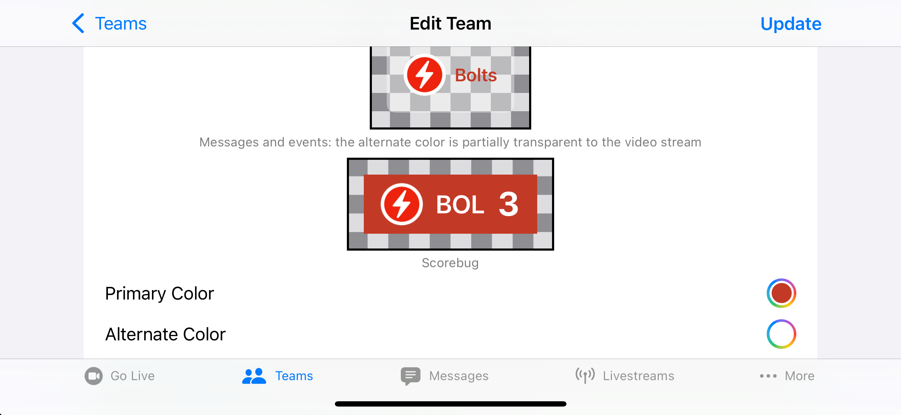
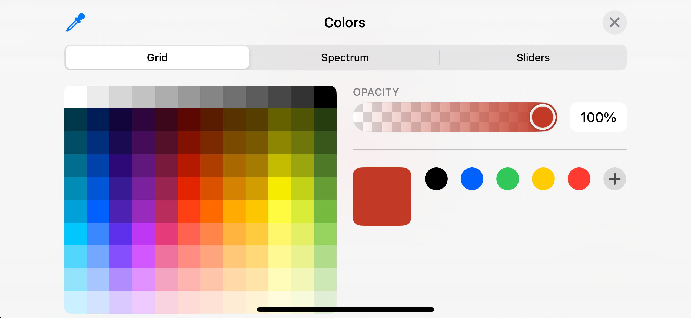
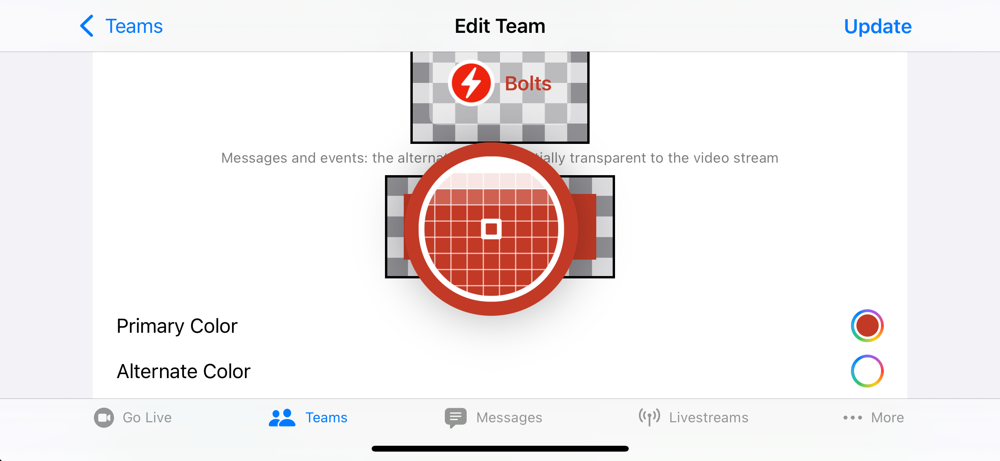

Add teams so scoreboards and team-based messages know which colors and logos to use.

## Add a Team
1. Open the Teams tab and tap **Add Team**.
2. Enter the team name and optionally the abbreviation.
3. Choose the sport.
4. Pick a team logo from your photo library (add it to Photos first).
5. Set the team's **Primary Color** and **Alternate Color**.
6. Set the team colors for your team using the color picker. If you want to use colors from the logo:

   

     
   

Tap the color button to open the Color Picker.

   

     
   

Tap the dropper to switch to the loupe tool.

   

     
   

Move the loupe tool to the color you want to use.

7. The live previews show how the colors will look with the logo: first in messages and event graphics (primary text on an alternate background), then on the scorebug.
Choose **Scorebug Background** to fill the scorebug with the primary or alternate color; the other color is used for the score. Tap **Swap Colors** to exchange the two colors.
8. Tap **Save**.

## Quick Add Team
On the Go Live Teams step, tap **Quick Add Team** to add a team without leaving Go Live.

1. Enter a 2 or 3 letter acronym, such as NHS.
2. Pick a team color, or tap **Custom Color** for any other.
3. Choose **Black** or **White** as the alternate color.
4. Tap **Save**.

The team is named after the acronym, and its logo is the acronym in the alternate color on the team color. It is added to the step's sport and selected as Home, or Away if Home is already picked. Edit it later in the Teams tab, like any other team.

## Tips
- Team colors populate scoreboards and team-format messages automatically.
- You can edit any team later by selecting it from the list.
- Teams are sport specific.
